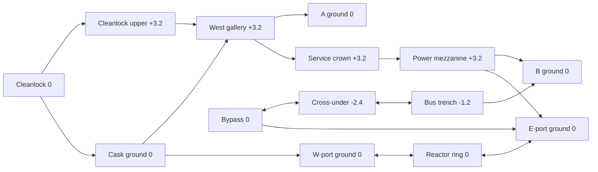
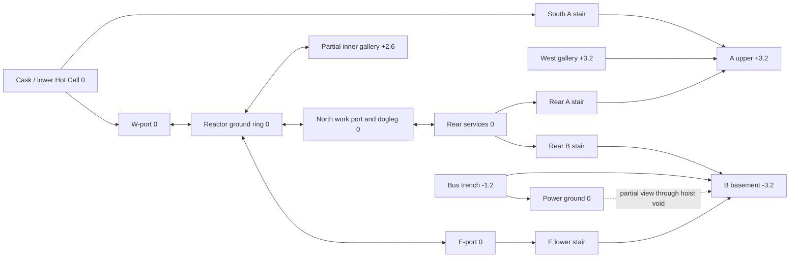

# Fusion complexity expansion — independent strategy proposals

Date: 2026-11-11. Reviewer: `skill_forward_review`.
Baseline: B04 / L03, source SHA-256
`67e6d4fc42c5262f0b968956dc00ca6b7a90b261b9a41d2b4134b70ecae7f3e6`.

The user now requests substantially more layout complexity, shortcuts and
verticality. These are two alternative structural packages, not repairs required
by the accepted B04 baseline. They were developed from the baseline plan, source,
compiled views and movement results before reading new candidate drawings or
other reviewers' expansion proposals. The prior design rationale is known from
the B04 assignment; this is independent proposal development, not a blind review.

Both retain 5v5 and two objectives. Reactor center is `(0,4)`; coordinates are
meters and Z-up. Keep the published vessel envelope, D-like section, central
solenoid and actual installed coil volumes. A proposed passage is not permission
to shrink the reactor, silently delete an intersected coil, or make its pit
walkable. Work decks and building circulation are invented assembly-state
architecture. Dimensions below are layout hypotheses, not clearance passes.

## Baseline opportunities

B04 has a meaningful ground-level ring but its destinations mostly return to
separate wings. The west upper gallery is a local detour/support route; the east
trench is a lower approach. Neither is part of an extensive alternate circulation
system. The full site-to-site replay is about 80.18 m. Ground defenders from the
centered spawn travel about 39.88 m to A and 45.54 m to B. These are physical
inspection distances, not first-contact or round timings.

The expansion should change what a player can do after reaching a known position.
It should let an upper commitment become a return route, let a lower approach
change sides of machinery, or make control of the reactor open a new destination.
Extra props, repeated doorways into the same view, and simply lengthening the
perimeter would not accomplish the requested change.

## CS-01 — Service crown and crossed wings

**Preferred development candidate:** preserve A and B at Z0, then join meaningful
upper journeys across the northern service building. The reactor still has its
three existing ground ports and remains the shorter central contest. The new
upper system is longer and changes elevation/entry relationships at its ends.

### Physical arrangement

| Change | Proposed dimensions and connections | Consequential relationship |
| --- | --- | --- |
| Upper service crown | Z+3.2; 2.6–3.0 m clear. Centerline approximately `(-20,16) → (-20,27) → (22,27) → (24,16)`. Add two occupied machinery rooms of roughly 5×6 m near the northern corners, with offset onward thresholds. | West gallery becomes a route to the east upper wing, rather than ending at A support. It passes above the existing rear route while remaining outside the bioshield. |
| West upper approach loop | Z+3.2; 3 m clear strip approximately x[-33,-29], y[-22,-4], then an eastward bridge to the existing gallery turn near `(-22,-4)`. An 8 m run/3.2 m rise stair starts in Cleanlock near `(-31,-30)` and reaches `(-31,-22)`. Retain the existing Cask gallery stair as the second transfer. | Cleanlock can commit to an upper journey or continue through Cask at ground level; the routes share a visible Cask volume before separating again. Losing the original stair no longer strands upper access. |
| East upper loop | Z+3.2; an L-shaped 3–4 m clear mezzanine along x[22,26], y[8,22] and x[22,32], y[19,22]. Entry stair near `(23,3,0) → (23,11,3.2)`; opposite stair approximately `(36,20,0) → (28,20,3.2)`. Join the crown near `(22,20,3.2)`. | E-port control can convert into height or remain a ground entry. A B defender can leave the site through the upper route while a teammate holds lower space. The objective remains on the uncovered ground side near `(35,17,0)`. |
| Transformer cross-under | A 2.4 m clear cable/service chase at Z−2.4, from the bypass side near `(24,-4)` to the trench side near `(34,-4)`. West transfer: `(24,-10,0) → (24,-4,-2.4)`; east transfer: `(34,-4,-2.4) → (34,0,-1.2)`. Provide at least 2.15 m finished headroom beneath the ground slab and explicit foundation islands clear of the route. | This makes a real local shortcut between the opposite sides of the transformer, rather than forcing return around one end. It is narrower and loses outside information. |

The cross-under refines the earlier quick suggestion of a Z−1.2 passage under
raised equipment. A deeper chase makes structural and standing clearance more
credible without suspending the whole transformer merely to create a tunnel.
Its nominal run is approximately 20–22 m including transfers; the competing
around-equipment journey must be measured between identical endpoints before
claiming a numerical saving.

Raise the affected Cleanlock, bus/Power and rear enclosures to suit occupied
upper floors; roof tops around +7.2 provide usable upper headroom. A 0.24 m
crown floor gives approximately 2.96 m clearance to the Z0 rear floor below.
Stair openings need actual slab boundaries and landings. Do not merely draw
stairs over the existing low roofs. Keep the machine hall roof and lifting
volume separate from these service-building roofs.

The north upper route should be an inhabited service sequence: two machinery
rooms, an intervening enclosed crossing, and visible upper/lower interfaces
at the ends. It should not be one uninterrupted shooting gallery. Do not add
a direct stair from the center of defender spawn onto the crown: initial access
comes from the wings and therefore has a deployment cost. This is a chosen
candidate relationship, not a universal rule against spawn stairs.

### What changes in a round

Before a plant, a western pair can split between Cask ground and Cleanlock upper.
The upper player can support an arrival, join A, or continue toward the crown.
That third decision is new. Continuing north gives up immediate support to the
ground partner; the defender does not have to pursue the upper player if the
site remains containable. The reactor probe offers a more direct central
transfer, but must win a port. Taking the longer crown avoids that particular
port duel while creating new duels in its occupied rooms and at its far exit.

Five defenders could begin as an A anchor, a west ground/upper partner, a B
anchor, an east ground/upper partner and a flexible reactor player. They cannot
also station separate permanent guards in both crown rooms and the cross-under.
A revealed upper crossing therefore prompts an actual choice: have the far
site partner receive it, pull the reactor player, or concede the upper arrival
and hold the objective below. The upper route's threat matters even if most
players stop short of crossing the entire map.

After A is planted, the same crown can become an attacker flank-containment
route or a defender return. An attacker already on it can threaten a B rotator;
an attacker still at A ground pays an ascent and substantial travel. Do not
credit every 2v2 planted side with an instant upper cutoff. Defenders who have
kept east upper control can return toward A through the crown, but must then
descend or gain an appropriate A firing position. The ground rear route remains
a competing, more direct objective-plane return.

At B, the cross-under lets a player disappear from the bypass and reappear at
the trench side without retreating to Cooling. Their old sighting ages once
that junction is reached. A teammate may hold the exposed upper/ground junction
while the traveler changes sides. If that teammate dies, the traveler must
check the far exit or abort; the tunnel does not give current information about
the destination. Defenders can contain its exits while contesting the objective
instead of chasing inside it.

In 3v3 or 2v2, teams must choose a local upper/lower relationship to retain and
concede remote territory. An upper hold should be abandoned when its lower
partner is gone, the relevant arrival has passed, or the objective requires
physical interaction. The route remains useful for a regroup or delayed return,
but its value depends on where the survivors already are.

### Sacrifices and comparison

This candidate creates substantial route overlap while keeping the known
objective geography. It also adds a long upper connection that could dilute the
reactor contest or turn into tedious corridor clearing. The test is whether
winning a crown room creates a timely different entry, not whether the route
appears on the navigation graph. Compare a pair already at west gallery choosing
crown versus ring/ground return, and the defender response from east upper.

Inspect the cross-under from both exits and the ramp/stair follower positions.
Inspect crown arrival into each wing against ground and upper opponents. Check
spawn offsets again after adding upper sightlines. Actual footstep inference,
utility clearing and coordinated trading remain engine questions.

## CS-02 — Stacked objectives and a fourth reactor connection

**The more disruptive candidate:** make the reactor the intermediate plane
between an upper A objective and a lower B objective, and deliberately reopen
the previously declined rear-to-reactor connection. This changes the composition
and objective approach structure rather than adding the CS-01 crown to B04.
Do not combine both full packages by default.

### Physical arrangement

| Change | Proposed dimensions and connections | Consequential relationship |
| --- | --- | --- |
| Upper Hot Cell objective | Move A to approximately `(-34,19,+3.2)`. Develop an upper floor around x[-38,-20], y[10,23], retaining a 5×7 m void around the cask/handling volume rather than filling the room with a solid second floor. Retain existing gallery access; add a 2.4 m clear south stair near x−35, y7..15 and a folded rear stair in the A-link bay x[-30,-21], y[23,30]. | Ground A becomes contested transit and approach containment. An attacker can pass underneath the objective floor to change the upper arrival, while an upper holder must choose which ascent to influence. |
| Lower Power objective | Move B to approximately `(35,17,−3.2)` in a basement x[22,40], y[8,24]. Keep ground Power as an occupied upper approach, with a 4×6 m hoist/service void near x[29,33], y[10,16]. Keep the plant out from directly beneath that opening. | Ground Power control gives partial information and pressure but does not itself reach the objective. A retaker must descend, or support a teammate who has. |
| B lower access | Three distinct transfers: E-port-side stair near `(23,8,0) → (23,16,−3.2)`; rear stair near `(36,24,0) → (36,16,−3.2)`; branch the bus trench toward a lower ramp from about `(35.5,0,−1.2)` to `(35.5,7,−3.2)`, retaining a separate ground exit. Use 2.4–2.8 m clear transfers with finished landings. | The three arrivals meet different sides of the lower handling volume. The existing trench becomes a route-choice point, while E port becomes a direct objective-plane conversion. |
| North reactor work port | Azimuth approximately 100 degrees from reactor center, between the installed 90/110-degree coil frames. A 2.2–2.6 m clear radial work bridge runs approximately `(-1.5,12.5,0) → (-3.2,22,0)`. Continue west to `(-9,22,0)`, then north through a new hall opening near `(-9,25,0)` to a rear arrival near `(-12,29,0)`. | Ring control now reaches the rear network. The two turns prevent a straight rear-to-ring view and make this a traveled flank, rather than a new line from spawn through the reactor. |
| Inner upper reactor gallery | Partial arc at Z+2.6, R4.4..6.6, approximately 30..150 degrees. Width 2.2 m; floor thickness about 0.20–0.24 m. End stairs turn through roughly 55–60 degrees toward the ground arc, with approximately 5.3–5.8 m centerline run for the 2.6 m rise. Retain the outer ground band R6.6..8.8 as a usable bypass, with rail thickness and player erosion checked. | The enclosed northern vessel supports two occupied heights. A player can take a slower elevated arc while a partner uses the outer ground band, then choose a port or the new north connection. |

The new north opening requires a **different unfinished assembly state**. Model
the 80–120-degree vessel sector as an intentionally absent upper/full sector,
using the existing D-section and seam geometry to describe what has not yet been
installed. Keep the coil frames and actual clear space between them; do not cut
through a complete coil. The azimuth/width is a proposal that must be checked
against the compiled coil faces, port framing and lower shell. If the passage
cannot fit, revise the temporary bridge or missing-sector state rather than
silently deforming the machine. This preserves the published envelope but does
change the baseline's five-full-sector assembly count, which was author choice.

The inner gallery's upper body reaches roughly Z+4.4; its underside is around
Z+2.36. Both appear compatible with the chosen D-section over R4.4..6.6, but
that prediction requires an actual radial section and standing/follower checks.
The remaining ground bypass must not be consumed by stair stringers or rails.
No required route depends on jumping, falling, ladders or unverified crouch
movement. The B basement also needs real slab openings and structural support;
it is not created by making the ground floor non-colliding.

### What changes in a round

A ground defender can no longer deny A merely by remaining behind the old cask
position. That position can contain an ascent or watch movement underneath the
site, while a teammate holds the upper objective. Attackers can pressure the
existing gallery and a south stair together, or win lower A to threaten the
rear ascent. Losing the upper teammate creates a new problem for the ground
player: climb into a changed site, hold the exit, or rotate through the reactor.

At B, taking ground Power does not complete the attack. One player must reach
the lower objective while another can support through the service void or
contain an alternate descent. If the lower player dies, the upper player has
information and partial pressure but still owes the descent. Defenders may
concede ground Power and contest the lower arrivals; they cannot assume the
ceiling makes B safe because the trench and E-port stair reach its plane.

The north port changes both initial and later assignments. A defender can
develop early reactor control from Rear Services, but the offset approach and
bridge are a real journey; no initial first-contact advantage is claimed.
Attackers who take the north arc can threaten the rear return and change site
through it, rather than returning to an outer port. This is a consequential
shortcut: it changes the reachable network from the ring, not just the length
of an already equivalent corridor. It may be too powerful, but B04's earlier
decision to exclude it is not a reason to refuse the newly authorized experiment.

A plausible five-player defensive allocation is upper A, lower-A/W-port
support, lower B, E-port/ground-Power support, and a north-port/reactor player.
There is no spare permanent watcher for every upper arc, rear return and trench
branch. A reactor loss can force a partner away from a site; attackers can use
that withdrawal to convert an outer approach. Conversely, committing two
attackers to the inner upper/ground pair leaves only three to carry the objective,
maintain outer pressure and contain returns. The complicated center is not free
team capacity.

After A is planted upstairs, attackers can threaten a reactor/rear cutoff from
below, but the player maintaining that threat is absent from the objective
floor. Retakers who arrive beneath A must still choose an ascent and coordinate
its timing. After B is planted below, an upper survivor can watch the hoist
opening or an arrival, but cannot physically interact from the floor above.
The planted side may abandon previously strong upper territory to reunite on
the objective plane. Thus the same architecture reverses the value of height
between the two sites and between approach and retake.

In a 2v2, a player already at North Arc can create a credible rear threat that
B04 did not permit. That deserves testing against the actual objective clock.
Two survivors still outside the reactor cannot claim that flank immediately.
With one support loss, controlling both ring heights may become a liability:
the remaining player can return to ground, concede the upper arc, or leave by
the nearby port. It should be possible to simplify the local plan without
requiring a full map retreat.

### Sacrifices and comparison

This is the stronger response to the request for a harder map. It requires new
site sections, new spawn/contact evidence and a revised reactor assembly study.
Its chief risks are an overly valuable north port, excessive overhead checking
at A, and a basement B that can be contained too cheaply at its transfers. These
are reasons for focused candidate comparison, not evidence of defects before
the geometry exists.

Test identical early allocations with the north port enabled and blocked in
separate variants. Record which territory is given up to contest it and whether
winning it creates a timely site threat. Compare A ground/upper approach and B
ground/lower approach with one support player removed. Check the inner gallery
against both ground followers and the new north entry. No full-circle upper
reactor loop or direct central-core bridge is proposed.

## Selection advice

Develop CS-01 first if retaining recognizable B04 approaches is valuable: it
adds a connected upper journey, a second west ascent relationship, an east upper
loop, and a genuine local lower shortcut. It is my favored candidate because
these additions have distinct jobs and can be staged against the accepted
baseline without changing objective planes.

Keep CS-02 as the serious competing candidate for the user's maximum-complexity
direction. It changes the player's mental model much more: two objective
planes, an occupied inner upper vessel arc, and an explicit rear/ring shortcut.
Do not reduce the comparison to a count of connections or elevations. Draw both
with actual slab/void boundaries, access paths and adjacent views, then compare
the concrete journeys above. Adopt a coherent package, with independent review
of its consequences; do not simply union all proposed connections.
